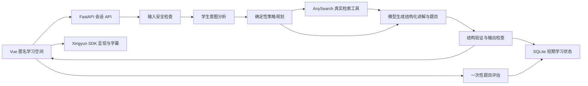

# 架构与实施计划

已按规格顺序：检查工作区及官方资料 → 新建独立 Vue/FastAPI 项目 → 赞助商服务边界 → 显式学习 Agent → 学习体验与仪表盘 → 测试及验收。

Agent 明确记录话题、年级、理解状态、策略、尝试次数、困惑次数、已完成检查和自报理解改善。状态不依赖浏览器聊天历史；服务端不给前端暴露检查答案。前端只显示当前会话摘要。

策略顺序：simple → analogy → steps → guided → example → simple；“换个例子”选择 interactive example 或 analogy。每次困惑都选择不同策略，保留上次解释作为模型输入，并拒绝完全重复输出。语义上是否真的换了方法仍须真实模型验收。

知识来源在当前话题保存，重讲时继续作为不可信资料输入；新问题重新决定是否检索。来源排序优先公共科学/教育机构，不能据域名宣称事实已经核实。

检查题只能提交一次；不同题的正确尝试累计，单题正确/“我懂了”只到 partially_understood。understood 在 UI 显示为“多次练习有进步”，不宣称客观掌握。自报改善与真实测评完全区分。

离线引擎只作为可明确选择的开发演示模块。真实模式中任何缺失服务都会显示限制，无静默替代。SDK 控制流与教学流程分离，渲染失败不影响文字阅读。

数据边界：Cookie 随机标识 → SQLite 小时级会话；匿名计数长期保留。无账号、无排名、无位置、无跨会话儿童画像。SQLite 是单进程 MVP 方案，公开部署需进一步设置请求速率、共享配额、监控和内容安全评测。
